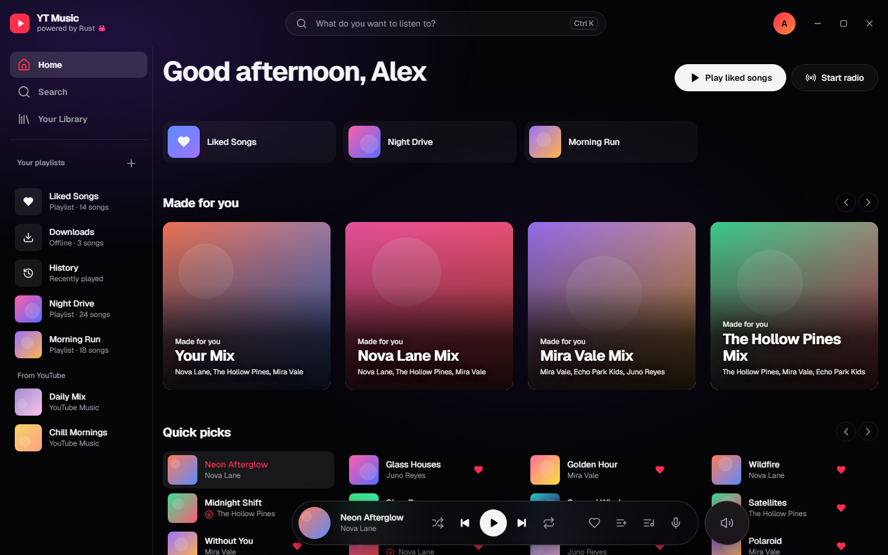
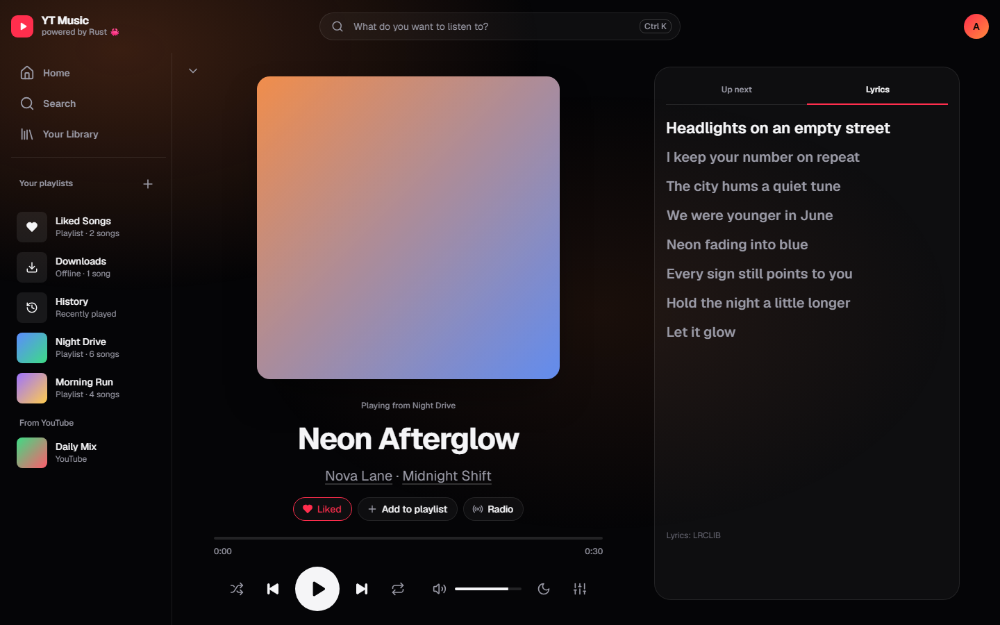
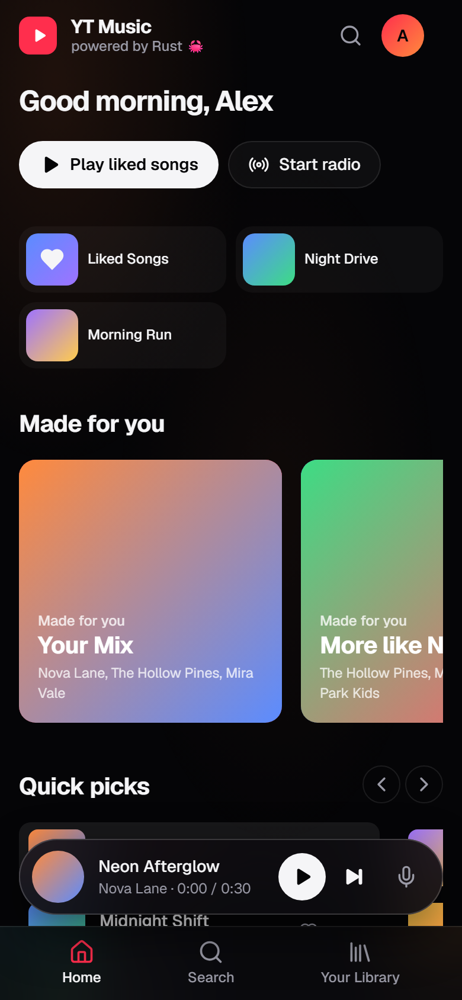
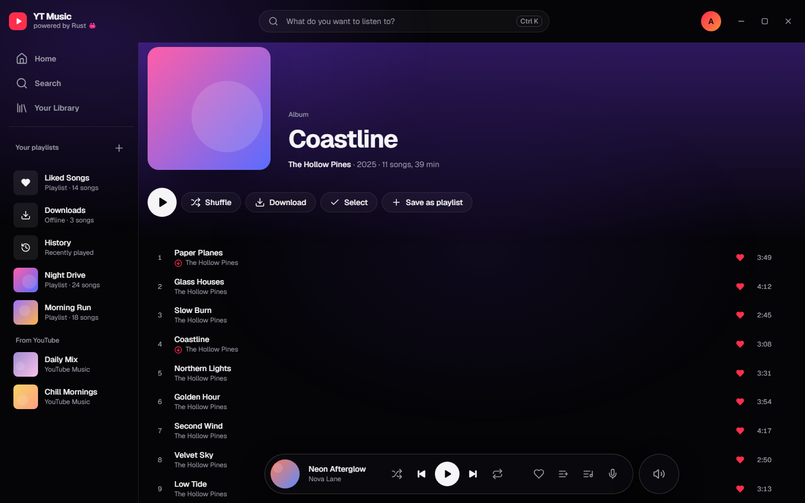
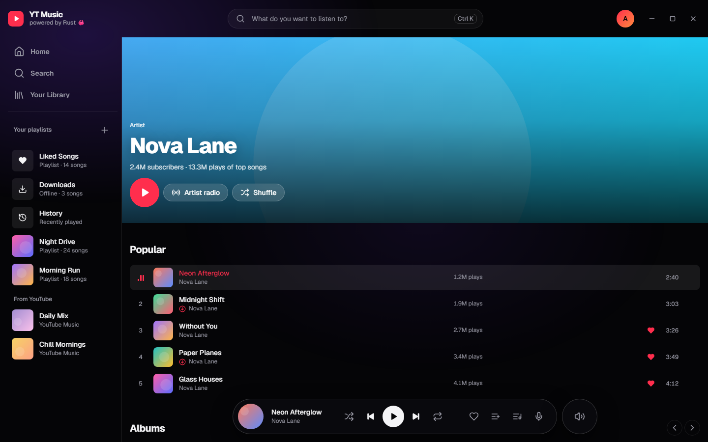
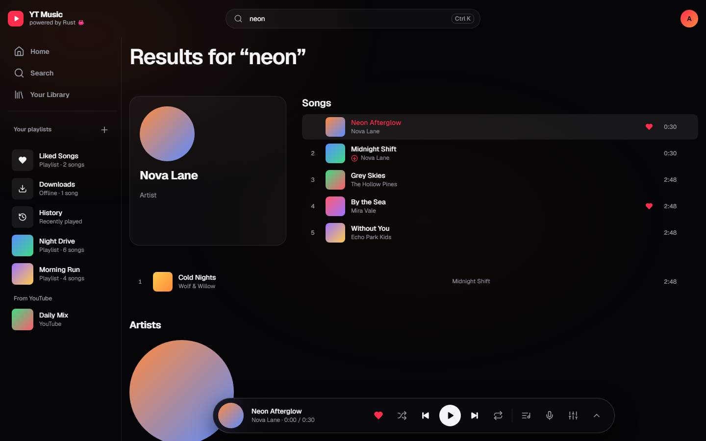

# YT Music

**English** · [Українська](README.uk.md) · [Русский](README.ru.md)

A fast, unofficial YouTube Music desktop client written in Rust (Tauri 2). Search, stream, build a library, and download music for offline listening, with an interface inspired by the big streaming apps.

> Unofficial project. Not affiliated with, endorsed by, or sponsored by Google LLC. YouTube and YouTube Music are trademarks of Google LLC.



| Player with synced lyrics | Phone layout |
|---|---|
|  |  |

<details><summary>More screenshots</summary>





</details>

## Features

- Search songs, albums, artists and playlists, with suggestions as you type
- Album, artist and playlist pages
- Player with queue, shuffle, repeat (all / one), seeking, volume and media keys
- Autoplay: when the queue runs out, similar songs (radio) are added
- Time-synced lyrics (Spotify-style: the current line lights up, click a line to jump), from [LRCLIB](https://lrclib.net) with YouTube Music lyrics as fallback
- Pages tinted with the cover's colour (computed in Rust)
- Library: liked songs, your own playlists and history, stored locally in SQLite
- Offline downloads in high quality (Opus ~160 kbps, or AAC ~128 kbps), stored encrypted in our own `.ytmc` format like Spotify's offline cache, so they play only inside the app
- Sign in with Google to import your YouTube Music likes and playlists
- One-click updates: desktop downloads the new installer, verifies its signature and restarts; Android downloads the new APK
- Interface in English, Ukrainian and Russian; two themes: **Classic** and **Glass** (design by [@dopedasya](https://github.com/dopedasya))
- Small and fast: ~14 MB binary, a song starts in ~0.2 s

## Install

Grab the installer for your platform from [Releases](../../releases).

- **Windows**: `YT.Music_x.y.z_Windows-x64-setup.exe`
- **macOS**: `*_macOS-Apple-Silicon.dmg` (M1/M2/M3/M4) or `*_macOS-Intel.dmg`. The app isn't notarized, so on first launch right-click it and choose **Open**.
- **Linux**: `*_Linux-x64.deb` (Debian/Ubuntu)
- **Android**: `*_Android.apk` (allow installing from unknown sources)

## Build from source

Requirements: [Rust](https://rustup.rs) (stable). On Windows you also need the MSVC Build Tools and WebView2 (preinstalled on Windows 10/11). On Linux you need the [Tauri prerequisites](https://v2.tauri.app/start/prerequisites/).

```sh
cd src-tauri
cargo run                          # dev build
cargo install tauri-cli --version "^2"
cargo tauri build                  # installer in target/release/bundle/
```

The frontend is plain HTML/CSS/JS in `ui/`, so no Node.js or bundler is needed.

## How it works

Most of the app is Rust; the web layer only renders and plays `<audio>`.

```
ui/                 frontend (no build step): app.js, player.js (thin), api.js, i18n.js, icons.js
src-tauri/src/
  lib.rs            startup, command registration (desktop + Android entry point)
  player.rs         queue engine: shuffle, repeat, autoplay radio, persistence
  playback.rs       player commands; records history, prefetches the next stream
  yt.rs             YouTube Music metadata (rustypipe) + audio stream resolution
  lyrics.rs         LRCLIB lookup, fuzzy matching, LRC parsing
  color.rs          dominant cover colour for page tints
  vault.rs          encrypted offline container (.ytmc, ChaCha20, seekable)
  downloads.rs      chunked downloads straight into the vault
  server.rs         local 127.0.0.1 HTTP server for <audio> (Range/seeking, decrypts offline files)
  auth.rs           "Sign in with Google" window
  db.rs             SQLite: likes, playlists, history, downloads, cache, settings
  ytdlp.rs          optional yt-dlp fallback (desktop only, checksum-verified)
```

- **Metadata** (search, albums, artists, radio, lyrics, account) comes from [rustypipe](https://codeberg.org/ThetaDev/rustypipe).
- **Audio URLs** come from a direct InnerTube `player` request with the visionOS client, which needs no JS player and no PO token. This resolver races rustypipe, and the first verified URL wins. On desktop, [yt-dlp](https://github.com/yt-dlp/yt-dlp) is a last-resort fallback; it is installed on first run and updated automatically.
- googlevideo rejects open-ended ranges, so the local proxy fetches upstream in bounded 4 MB chunks and stitches them into one stream for the player. Seeking works, and stream URLs never reach the web layer.
- The next song in the queue is resolved in advance, so skipping is instant.

## Tests

```sh
cargo test                            # offline tests
cargo test -- --ignored --nocapture   # live tests against real YouTube
```

## Keyboard shortcuts

| Key | Action |
|---|---|
| Space | Play / pause |
| ← / → | Seek −5 / +5 s |
| Ctrl+← / Ctrl+→ | Previous / next |
| Ctrl+↑ / Ctrl+↓ | Volume |
| Ctrl+K or / | Search |
| Alt+L | Like current song |
| Alt+← | Back |

## License

[GPL-3.0](LICENSE). The project depends on rustypipe, which is GPL-3.0, so the app as a whole is distributed under the same license.
