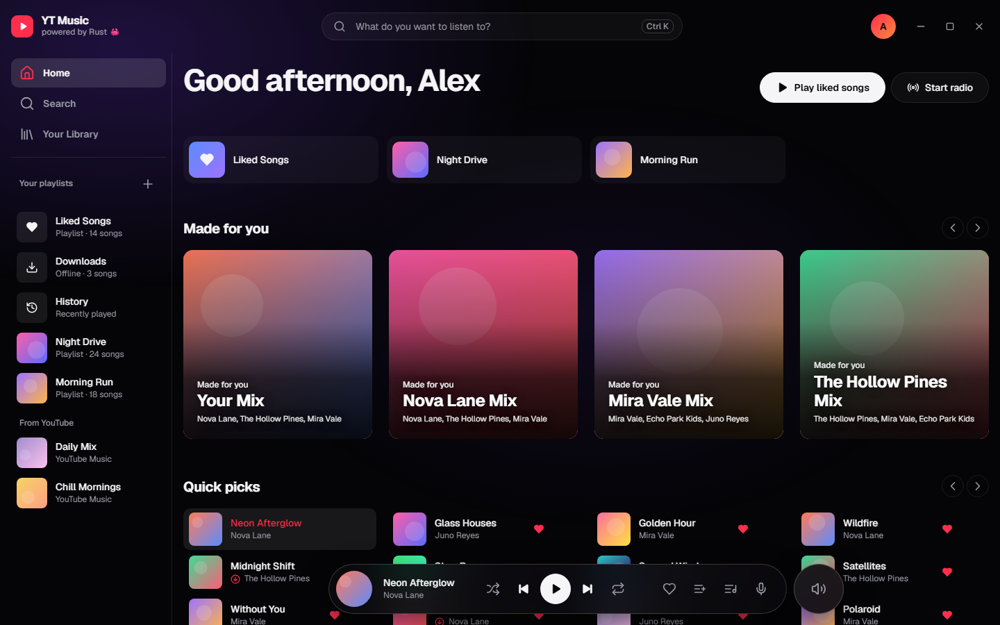
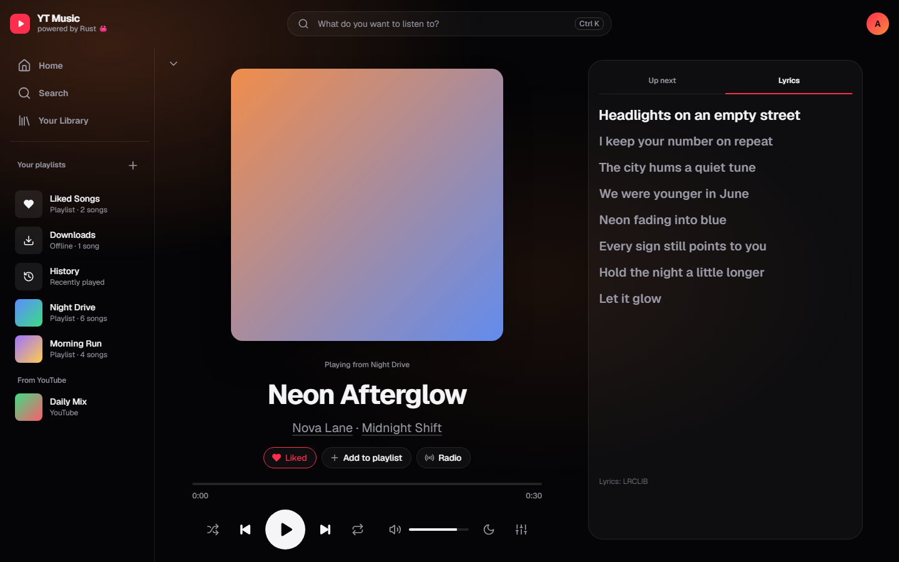
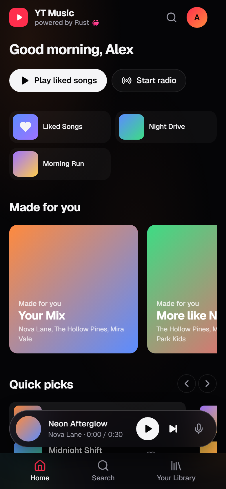
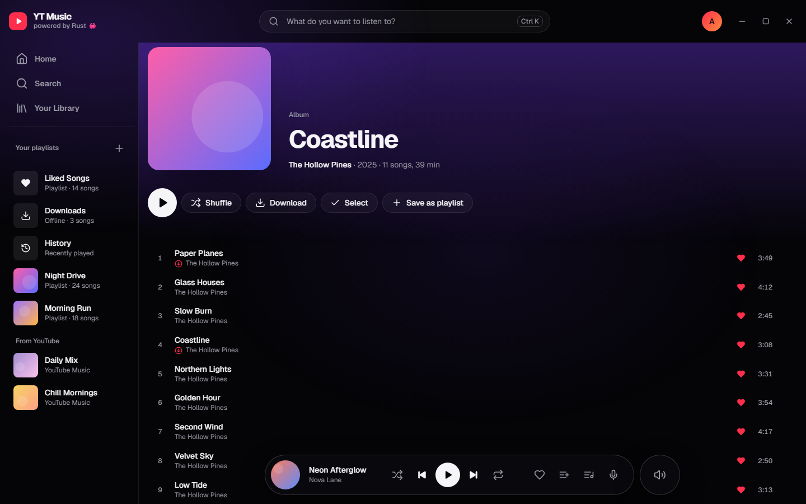
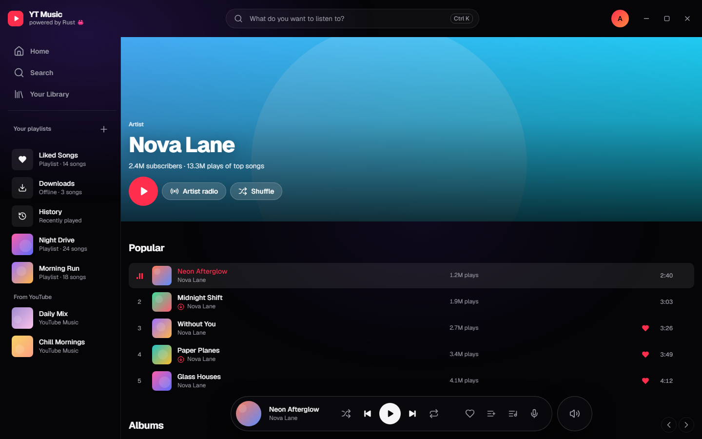
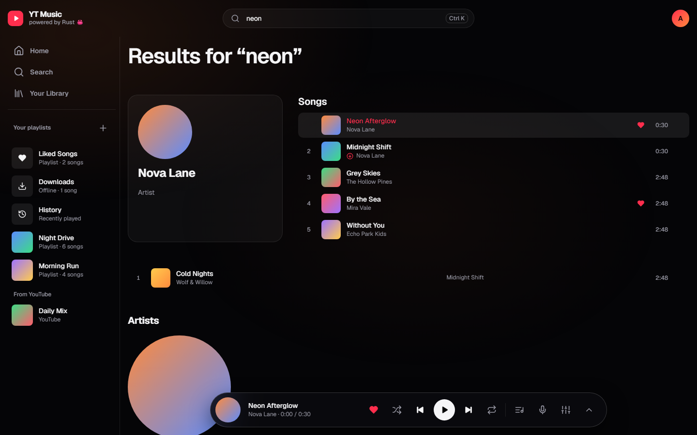

<p align="center"></p>

<h1 align="center">YT Music</h1>

<p align="center"><b>English</b> · <a href="README.uk.md">Українська</a> · <a href="README.ru.md">Русский</a></p>

A fast, unofficial YouTube Music client for Windows, macOS, Linux and Android, written in Rust (Tauri 2). Search, stream, build your library and download music for offline listening — including 18+ songs on your own account.

> Unofficial project. Not affiliated with, endorsed by, or sponsored by Google LLC. YouTube and YouTube Music are trademarks of Google LLC.



| Player with synced lyrics | Phone |
|---|---|
|  |  |

<details><summary>More screenshots</summary>





</details>

## Features

**Listening**
- Home made for you: your mix and a mix for each favourite artist, from your history and likes; quick picks, top songs chart, new releases, recently played
- Search songs, albums, artists and playlists with suggestions; album, artist (with play counts) and playlist pages; on an artist, *Show all* opens every song, album and single
- Songs first: charts, artist pages and radio are songs only; search also lists videos (minus/instrumental, covers, live versions) separately, and they play as audio only
- A player that expands from the bottom bar to full screen: big cover, controls, and *Up next* / *Lyrics* right beside it
- Queue, shuffle, repeat (all / one), seeking from the bar, volume, sleep timer, media keys
- Autoplay: when the queue runs out, similar songs (radio) keep playing
- Time-synced lyrics (the current line lights up, click a line to jump), from [LRCLIB](https://lrclib.net) with YouTube Music lyrics as fallback
- 10-band equalizer with presets
- 18+ songs play when you're signed in (age-verified account)

**Library**
- Sidebar with your library and playlists, always at hand
- Liked songs, your own playlists and history, stored locally in SQLite
- Sign in with Google to bring your YouTube likes and playlists; account menu on your avatar (sync, switch account, sign out)
- Select several songs, or all of them, on any page: play next, add to a playlist, download or remove at once
- Share your playlists by link: *Share* puts the playlist on your YouTube account as unlisted and copies its music.youtube.com link. Open a friend's link with *+ → Add by link* (or paste it into search) and save the playlist to your library
- Likes and unlikes reach your YouTube Music account
- Offline downloads (high or standard quality) saved as plain `.m4a` / `.webm` files named "Artist - Title" (in your Music folder on desktop), so other players can open them too

**App**
- Design by [@dopedasya](https://github.com/dopedasya) in dark, light or system mode, tinted with the cover's colour; light effects (no live blur or moving background), so it stays smooth on any computer or phone
- Own title bar on Windows/Linux; shows up as "YT Music" in the Windows media overlay
- English, Ukrainian and Russian
- One-click updates: desktop installs a signed update and restarts; Android downloads the new APK. The app checks at start, every 3 hours and when you come back to it

## Install

Grab the file for your platform from [Releases](../../releases). Each release lists what changed.

> **Windows and Android** get the current version. **macOS, Linux and iPhone are archived for now** and will be released later; the last macOS and Linux build is [1.0.1](../../releases/tag/v1.0.1).

| Platform | File |
|---|---|
| Windows | `*_Windows-x64-setup.exe` |
| Android | `*_Android.apk` (allow installing from unknown sources) |

### System requirements

| Platform | Minimum |
|---|---|
| Windows | Windows 10 or 11, 64-bit (WebView2 is built in) |
| Android | Android 7.0+ on a 64-bit ARM phone, with Android System WebView kept up to date (Google Play) |

On first start the desktop app downloads [yt-dlp](https://github.com/yt-dlp/yt-dlp) (about 18 MB) as a backup way to play music if YouTube changes something. An internet connection is needed except for downloaded songs.

## Build from source

Requirements: [Rust](https://rustup.rs) (stable). On Windows you also need the MSVC Build Tools and WebView2 (preinstalled on Windows 10/11). On Linux you need the [Tauri prerequisites](https://v2.tauri.app/start/prerequisites/).

```sh
cd src-tauri
cargo run                          # dev build
cargo install tauri-cli --version "^2"
cargo tauri build                  # installer in target/release/bundle/
```

The frontend is plain HTML/CSS/JS in `ui/`, so no Node.js or bundler is needed.

## How it works

The logic is Rust; the web layer renders the interface and plays `<audio>`.

```
ui/                 interface (no build step): app.js, player.js, api.js, eq.js, i18n.js, icons.js,
                    ejs/ (stream challenge solver, see below)
src-tauri/src/
  lib.rs            startup, command registration (desktop + Android entry point)
  player.rs         queue engine: shuffle, repeat, autoplay radio, persistence
  playback.rs       player commands; history, prefetching the next streams
  yt.rs             YouTube Music metadata (rustypipe) + audio stream resolution
  ytdlp.rs          yt-dlp (desktop): installed and updated automatically, checksum-verified
  jsplayer.rs       solves YouTube's stream challenges without yt-dlp (Android)
  server.rs         local 127.0.0.1 server for <audio> (Range/seeking, decrypts offline files)
  vault.rs          reads encrypted downloads from 1.1.0 and older (they are turned into plain files on update)
  downloads.rs      chunked downloads straight into the vault
  lyrics.rs         LRCLIB lookup, fuzzy matching, LRC parsing
  recommend.rs      "made for you" mixes from your history and likes
  color.rs          dominant cover colour for tints
  auth.rs / account.rs   "Sign in with Google", account name and avatar
  media.rs          Windows media overlay (system media controls)
  db.rs             SQLite: likes, playlists, history, downloads, cache, settings
```

- **Metadata** (search, albums, artists, charts, radio, account) comes from [rustypipe](https://codeberg.org/ThetaDev/rustypipe).
- **Audio on desktop:** the same path as on Android (below): the built-in resolvers, signed in for 18+ songs. [yt-dlp](https://github.com/yt-dlp/yt-dlp) is only the last resort when they fail.
- **Audio on Android** (no yt-dlp): a direct InnerTube `player` request with the visionOS client races rustypipe. For 18+ songs the app makes a signed request and solves the stream URL challenges with yt-dlp's own solver ([yt-dlp/ejs](https://github.com/yt-dlp/ejs), Unlicense) running in the webview's JS engine; the parsed player is cached on disk.
- googlevideo rejects open-ended ranges, so the local proxy fetches upstream in bounded 4 MB chunks and stitches them into one stream. Seeking works, and stream URLs never reach the web layer.

## Tests

```sh
cargo test                            # offline tests
cargo test -- --ignored --nocapture   # live tests against real YouTube
```

## Keyboard shortcuts

| Key | Action |
|---|---|
| Space | Play / pause |
| ← / → | Seek −5 / +5 s |
| Ctrl+← / Ctrl+→ | Previous / next |
| Ctrl+↑ / Ctrl+↓ | Volume |
| Ctrl+K or / | Search |
| Alt+L | Like current song |
| Esc | Close the player or a menu |
| Alt+← | Back |

## License

[GPL-3.0](LICENSE). The project depends on rustypipe, which is GPL-3.0, so the app as a whole is distributed under the same license. The vendored stream challenge solver (`ui/ejs`) is from yt-dlp/ejs (Unlicense).
