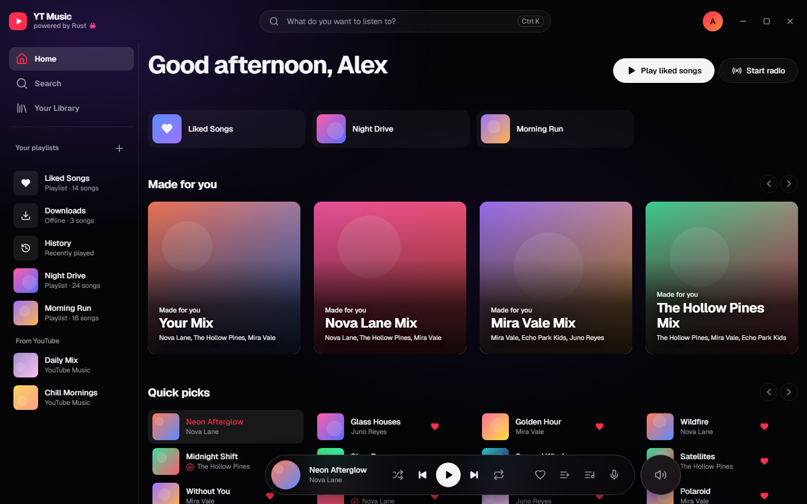
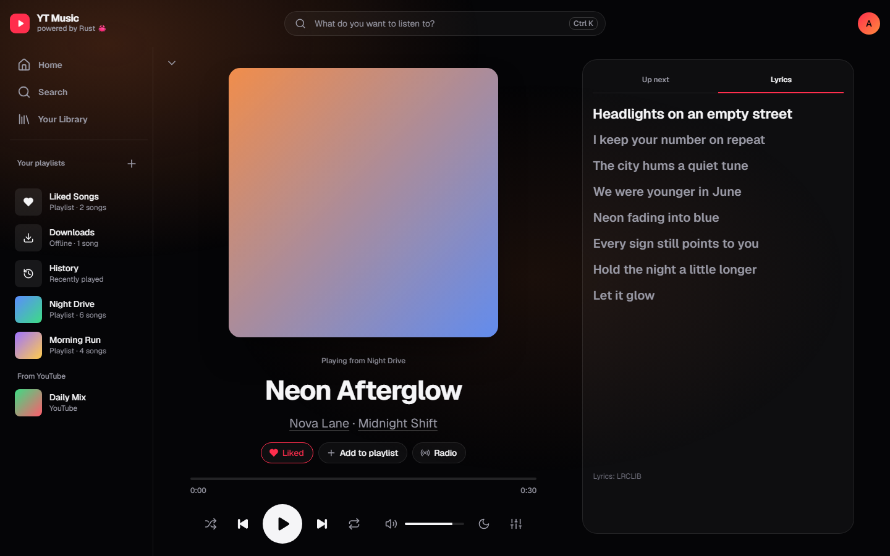
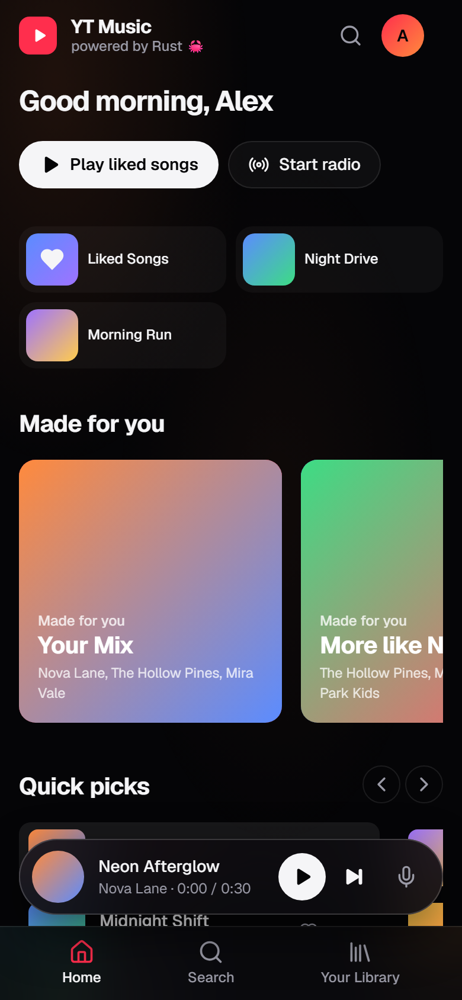
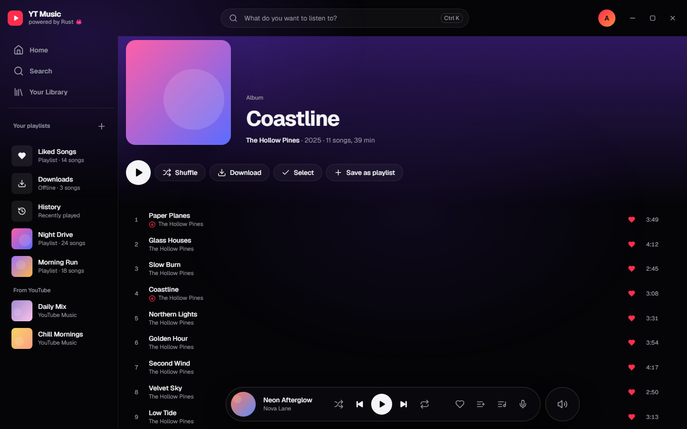
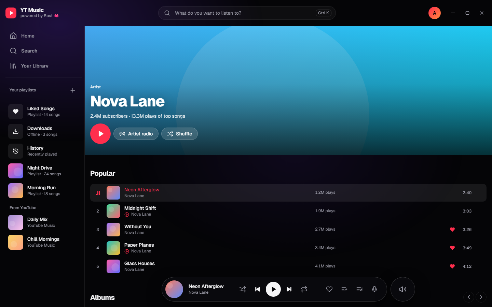
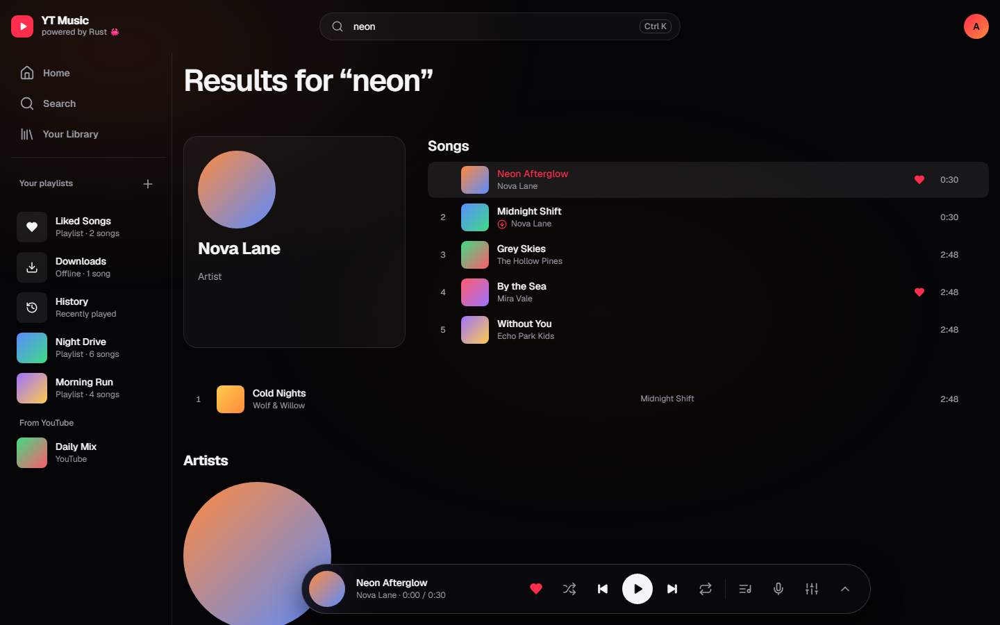

<p align="center"></p>

<h1 align="center">YT Music</h1>

<p align="center"><a href="README.md">English</a> · <a href="README.uk.md">Українська</a> · <b>Русский</b></p>

Быстрый неофициальный клиент YouTube Music для Windows, macOS, Linux и Android, написанный на Rust (Tauri 2). Поиск, стриминг, библиотека и загрузка музыки для офлайн-прослушивания — включая 18+ треки на твоём аккаунте.

> Неофициальный проект, не связан с Google LLC и не одобрен ею. YouTube и YouTube Music — товарные знаки Google LLC.



| Плеер с синхронизированным текстом | На телефоне |
|---|---|
|  |  |

<details><summary>Ещё скриншоты</summary>





</details>

## Возможности

**Прослушивание**
- Главная для тебя: миксы из истории и лайков, быстрый выбор, чарт топ-треков, новые релизы, недавно прослушанное
- Поиск треков, альбомов, исполнителей и плейлистов с подсказками; страницы альбомов, исполнителей (с числом прослушиваний) и плейлистов
- Только песни: клипы убраны из поиска, чартов, страниц исполнителей и радио
- Плеер, который разворачивается из нижней панели на весь экран: большая обложка, управление, а рядом «Дальше» / «Текст»
- Очередь, перемешивание, повтор (вся очередь / один трек), перемотка с панели, громкость, таймер сна, медиаклавиши
- Автовоспроизведение: когда очередь заканчивается, играют похожие треки (радио)
- Синхронизированные тексты (текущая строка подсвечивается, клик по строке — перемотка) из [LRCLIB](https://lrclib.net), запасной вариант — тексты YouTube Music
- 10-полосный эквалайзер с пресетами
- 18+ треки играют, когда ты вошёл (аккаунт с подтверждённым возрастом)

**Библиотека**
- Боковая панель с библиотекой и плейлистами всегда под рукой
- Лайки, свои плейлисты и история хранятся локально в SQLite
- Вход через Google переносит лайки и плейлисты из YouTube; меню аккаунта на аватаре (синхронизация, смена аккаунта, выход)
- Офлайн-загрузки (высокое или обычное качество) в собственном зашифрованном формате `.ytmc`: играют только в YT Music

**Приложение**
- Стеклянный дизайн (от [@dopedasya](https://github.com/dopedasya)): тёмная, светлая или системная тема, цвет обложки как фоновый свет
- Своя верхняя панель на Windows/Linux; в медиаоверлее Windows приложение подписано как «YT Music»
- Английский, украинский и русский
- Обновления в один клик: на ПК ставится подписанное обновление с перезапуском, на Android скачивается новый APK

## Установка

Скачай файл для своей платформы из [Releases](../../releases). В каждом релизе есть список изменений.

| Платформа | Файл |
|---|---|
| Windows | `*_Windows-x64-setup.exe` |
| macOS, Apple Silicon (M1/M2/M3/M4) | `*_macOS-Apple-Silicon.dmg` |
| macOS, Intel | `*_macOS-Intel.dmg` |
| Linux (Debian/Ubuntu) | `*_Linux-x64.deb` |
| Android | `*_Android.apk` (разреши установку из неизвестных источников) |

Сборки для macOS не нотаризованы: при первом запуске нажми на приложение правой кнопкой и выбери **Открыть**.

## Сборка из исходников

Нужно: [Rust](https://rustup.rs) (stable). На Windows также MSVC Build Tools и WebView2 (уже есть в Windows 10/11). На Linux — [зависимости Tauri](https://v2.tauri.app/start/prerequisites/).

```sh
cd src-tauri
cargo run                          # dev-сборка
cargo install tauri-cli --version "^2"
cargo tauri build                  # установщик в target/release/bundle/
```

Интерфейс — обычные HTML/CSS/JS в `ui/`, Node.js и бандлер не нужны.

## Как это работает

Логика на Rust; веб-слой только рисует интерфейс и играет `<audio>`. Структуру файлов см. в [английском README](README.md#how-it-works).

- **Метаданные** (поиск, альбомы, исполнители, чарты, радио, аккаунт) — из [rustypipe](https://codeberg.org/ThetaDev/rustypipe).
- **Аудио на ПК:** каждый трек идёт через [yt-dlp](https://github.com/yt-dlp/yt-dlp), от имени твоего аккаунта, если ты вошёл, поэтому 18+ тоже играют. Одновременно максимум 3 процесса yt-dlp, один трек не резолвится дважды, ссылки кэшируются до истечения срока, а два следующих трека (и трек под курсором) готовятся заранее — переключение без ожидания.
- **Аудио на Android** (yt-dlp нет): прямой запрос InnerTube `player` клиентом visionOS соревнуется с rustypipe. Для 18+ приложение делает подписанный запрос и расшифровывает ссылку решателем самого yt-dlp ([yt-dlp/ejs](https://github.com/yt-dlp/ejs), Unlicense) в JS-движке WebView; разобранный плеер кэшируется на диск.
- googlevideo не принимает открытые диапазоны, поэтому локальный прокси тянет данные кусками по 4 МБ и склеивает их в один поток. Перемотка работает, а ссылки на потоки не попадают в веб-слой.

## Тесты

```sh
cargo test                            # офлайн-тесты
cargo test -- --ignored --nocapture   # живые тесты с реальным YouTube
```

## Горячие клавиши

| Клавиша | Действие |
|---|---|
| Пробел | Играть / пауза |
| ← / → | Перемотка −5 / +5 с |
| Ctrl+← / Ctrl+→ | Предыдущий / следующий |
| Ctrl+↑ / Ctrl+↓ | Громкость |
| Ctrl+K или / | Поиск |
| Alt+L | Лайкнуть текущий трек |
| Esc | Закрыть плеер или меню |
| Alt+← | Назад |

## Лицензия

[GPL-3.0](LICENSE). Проект зависит от rustypipe под GPL-3.0, поэтому всё приложение распространяется под той же лицензией. Встроенный решатель (`ui/ejs`) — из yt-dlp/ejs (Unlicense).
