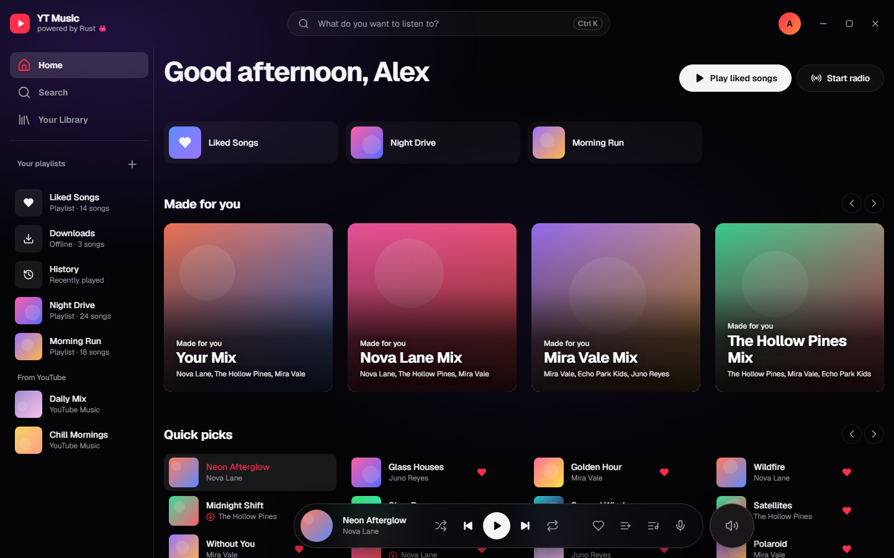
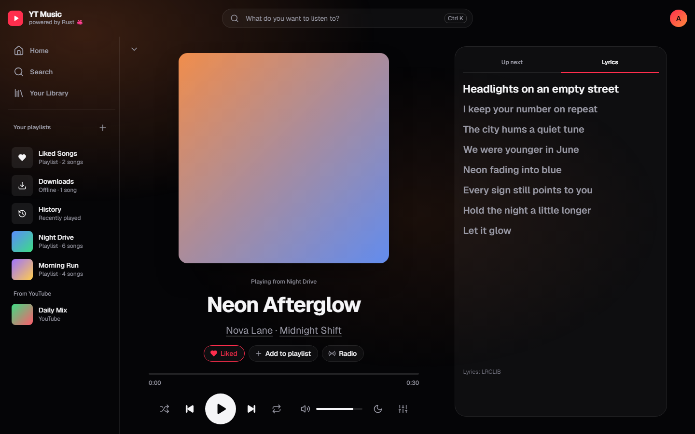
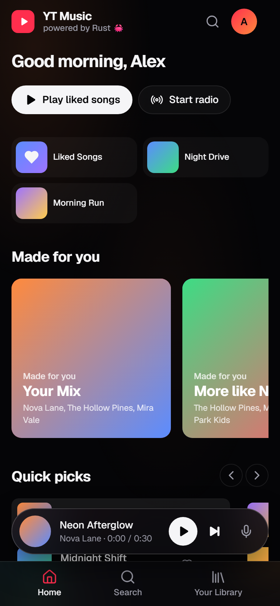
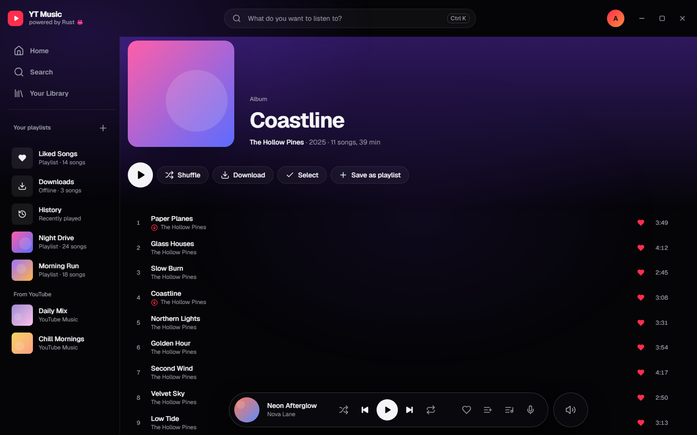
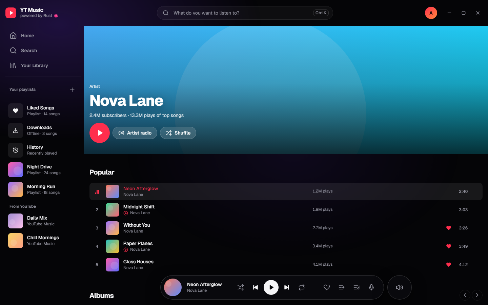
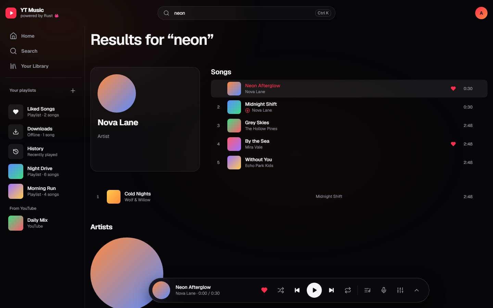

<p align="center"></p>

<h1 align="center">YT Music</h1>

<p align="center"><a href="README.md">English</a> · <b>Українська</b> · <a href="README.ru.md">Русский</a></p>

Швидкий неофіційний клієнт YouTube Music для Windows, macOS, Linux і Android, написаний на Rust (Tauri 2). Пошук, стрімінг, бібліотека й завантаження музики для офлайн-прослуховування — зокрема 18+ треків на твоєму акаунті.

> Неофіційний проєкт, не пов'язаний з Google LLC і не схвалений нею. YouTube і YouTube Music — торгові марки Google LLC.



| Плеєр із синхронізованим текстом | На телефоні |
|---|---|
|  |  |

<details><summary>Ще скріншоти</summary>





</details>

## Можливості

**Слухання**
- Головна для тебе: твій мікс і мікс на кожного улюбленого виконавця з твоєї історії та вподобань; швидкий вибір, чарт топ-треків, нові релізи, нещодавно прослухане
- Пошук треків, альбомів, виконавців і плейлистів з підказками; сторінки альбомів, виконавців (з кількістю прослуховувань) і плейлистів
- Лише пісні: кліпи прибрано з пошуку, чартів, сторінок виконавців і радіо
- Плеєр, що розгортається з нижньої панелі на весь екран: велика обкладинка, керування, а поруч «Далі» / «Текст»
- Черга, перемішування, повтор (уся черга / один трек), перемотка з панелі, гучність, таймер сну, медіаклавіші
- Автовідтворення: коли черга закінчується, грають схожі треки (радіо)
- Синхронізовані тексти (поточний рядок підсвічується, клік по рядку — перемотка) з [LRCLIB](https://lrclib.net), запасний варіант — тексти YouTube Music
- 10-смуговий еквалайзер із пресетами
- 18+ треки грають, коли ти увійшов (акаунт із підтвердженим віком)
- На Windows, macOS і Linux після входу музика грає через вебплеєр самого YouTube Music: пісні стартують одразу й не обриваються посередині

**Бібліотека**
- Бічна панель із бібліотекою й плейлистами завжди під рукою
- Вподобане, власні плейлисти й історія зберігаються локально в SQLite
- Вхід через Google переносить вподобане й плейлисти з YouTube; меню акаунта на аватарі (синхронізація, зміна акаунта, вихід)
- Вибір кількох пісень або всіх одразу на будь-якій сторінці: грати далі, додати в плейлист, завантажити чи прибрати
- Лайки ставляться й знімаються і у твоєму акаунті YouTube Music
- Офлайн-завантаження (висока або звичайна якість) у власному зашифрованому форматі `.ytmc`: грають лише в YT Music

**Застосунок**
- Скляний дизайн (від [@dopedasya](https://github.com/dopedasya)): темна, світла або системна тема, колір обкладинки як фонове світло
- Власна верхня панель на Windows/Linux; у медіаоверлеї Windows застосунок підписаний як «YT Music»
- Англійська, українська й російська
- Оновлення в один клік: на ПК встановлюється підписане оновлення з перезапуском, на Android завантажується новий APK

## Встановлення

Завантаж файл для своєї платформи з [Releases](../../releases). У кожному релізі є список змін.

> Актуальна версія — для **Windows та Android**. **macOS, Linux та iPhone поки в архіві** й будуть випущені пізніше; остання збірка для macOS і Linux — [1.0.1](../../releases/tag/v1.0.1).

| Платформа | Файл |
|---|---|
| Windows | `*_Windows-x64-setup.exe` |
| Android | `*_Android.apk` (дозволь встановлення з невідомих джерел) |

### Системні вимоги

| Платформа | Мінімум |
|---|---|
| Windows | Windows 10 або 11, 64-біт (WebView2 уже вбудований) |
| Android | Android 7.0+ на 64-бітному ARM-телефоні, з оновленим Android System WebView (Google Play) |

На ПК під час першого запуску застосунок завантажує [yt-dlp](https://github.com/yt-dlp/yt-dlp) (близько 18 МБ) для відтворення. Інтернет потрібен, окрім завантажених треків.

## Збирання з коду

Потрібно: [Rust](https://rustup.rs) (stable). На Windows також MSVC Build Tools і WebView2 (вже є в Windows 10/11). На Linux — [залежності Tauri](https://v2.tauri.app/start/prerequisites/).

```sh
cd src-tauri
cargo run                          # dev-збірка
cargo install tauri-cli --version "^2"
cargo tauri build                  # інсталятор у target/release/bundle/
```

Інтерфейс — звичайні HTML/CSS/JS у `ui/`, Node.js і бандлер не потрібні.

## Як це працює

Логіка на Rust; вебшар лише малює інтерфейс і грає `<audio>`. Структуру файлів див. в [англійському README](README.md#how-it-works).

- **Метадані** (пошук, альбоми, виконавці, чарти, радіо, акаунт) — з [rustypipe](https://codeberg.org/ThetaDev/rustypipe).
- **Аудіо на ПК:** після входу пісні грає вебплеєр самого YouTube Music у прихованому вікні (`webplayer.rs`): наш інтерфейс ним керує й показує його стан. Пісні стартують одразу, 18+ грають, а YouTube показує свою рекламу, як на сайті. Гість, завантажені пісні й запасний варіант (якщо сайт не запустив пісню) грають через вбудований плеєр нижче, а потоки дістає [yt-dlp](https://github.com/yt-dlp/yt-dlp).
- **Аудіо на Android** (yt-dlp немає): прямий запит InnerTube `player` клієнтом visionOS змагається з rustypipe. Для 18+ застосунок робить підписаний запит і розшифровує посилання розв'язувачем самого yt-dlp ([yt-dlp/ejs](https://github.com/yt-dlp/ejs), Unlicense) у JS-рушії WebView; розібраний плеєр кешується на диск.
- googlevideo не приймає відкриті діапазони, тож локальний проксі тягне дані шматками по 4 МБ і склеює їх в один потік. Перемотка працює, а посилання на потоки не потрапляють у вебшар.

## Тести

```sh
cargo test                            # офлайн-тести
cargo test -- --ignored --nocapture   # живі тести з реальним YouTube
node tests/player.test.mjs            # перемикання рушіїв плеєра (інтерфейс, підставний бекенд)
```

## Гарячі клавіші

| Клавіша | Дія |
|---|---|
| Пробіл | Грати / пауза |
| ← / → | Перемотка −5 / +5 с |
| Ctrl+← / Ctrl+→ | Попередній / наступний |
| Ctrl+↑ / Ctrl+↓ | Гучність |
| Ctrl+K або / | Пошук |
| Alt+L | Вподобати поточний трек |
| Esc | Закрити плеєр або меню |
| Alt+← | Назад |

## Ліцензія

[GPL-3.0](LICENSE). Проєкт залежить від rustypipe під GPL-3.0, тому весь застосунок поширюється під тією ж ліцензією. Вбудований розв'язувач (`ui/ejs`) — з yt-dlp/ejs (Unlicense).
